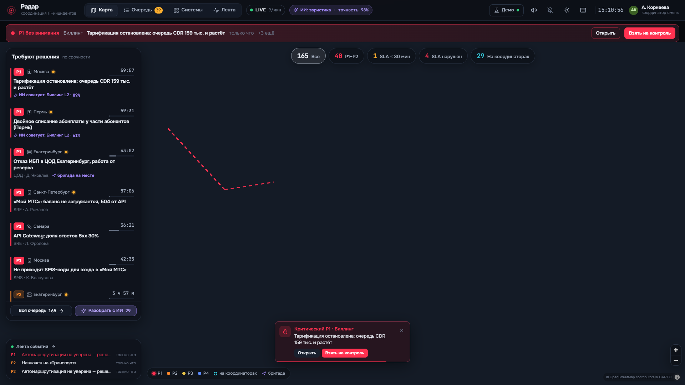

# Радар инцидентов — кейс МТС, Cyber Garden

Дашборд для координаторов IT-инцидентов. Координатор видит сотни инцидентов, понимает за секунду, где горит, кто
решает и сколько осталось до нарушения SLA, и не упускает новые P1, пока разбирается с одним.


## Запуск

Нужен Node.js 20 или новее.

```powershell
cd apps/mts-incidents
npm install
npm run dev
```

Откройте <http://localhost:5190>. API, поток событий и фронтенд работают на одном порту, отдельный dev-сервер не нужен.

| Команда | Что делает |
|---|---|
| `npm run dev` | разработка: сервер + Vite с горячей перезагрузкой |
| `npm start` | прод: собирает фронтенд и раздаёт его тем же сервером |
| `npm test` | тесты ИИ-эвристик (точность подсказки команды, рост риска, поиск первопричины) |
| `npm run typecheck` | проверка типов |

### ИИ: Claude или эвристика

Без ключа ИИ работает на эвристиках: мгновенно, офлайн, демо не ломается. Если задать ключ, Claude уточняет разбор
поверх эвристики (модель `claude-opus-5-5`, структурированный ответ, низкое усилие ради скорости):

```powershell
copy .env.example .env   # и впишите ANTHROPIC_API_KEY
```

Эвристика отвечает сразу, ответ Claude приходит через поток и заменяет текст в карточке. Новые P1 разбираются через
Claude автоматически, остальные — когда координатор открывает карточку. При ошибке, отказе модели или неверном ключе
дашборд остаётся на эвристике и пишет об этом в шапке. Для отказов включён серверный fallback
(`fallbacks: "default"`).

## Как кейс закрыт

### 1. Экран, который читается с первого взгляда

- **Сводка** сверху: открыто, критичные P1+P2, «SLA истекает < 30 мин», «SLA нарушен», «на координаторах», «решено за
  час» со средним временем решения. Клик по плитке фильтрует очередь.
- **Карта систем**: 12 систем МТС (биллинг, мобильная сеть, ядро, «Мой МТС», ЛК, платежи, ЦОД, API, KION, домашний
  интернет, контакт-центр, SMS). Цвет — худший открытый приоритет, полоска — распределение P1–P4, система с P1
  подсвечена. Клик фильтрует очередь по системе.
- **Очередь по срочности**, а не по времени: приоритет + близость SLA (с весом по приоритету) + ИИ-риск + «никто не
  взял». В строке — где (система › сервис · регион), кто (команда и исполнитель или «Координаторы» с подсказкой ИИ),
  риск и таймер SLA с полоской.
- **Карточка инцидента**: три блока «Где / Кто решает / До нарушения SLA», влияние на абонентов, тренд, связанные
  инциденты, действия: взять на контроль, передать команде, повысить приоритет, эскалировать, решён.

### 2. Внимание к важному, в реальном времени

Поток идёт через Server-Sent Events: снимок при подключении, дальше только изменения; при обрыве браузер
переподключается сам.

| Событие | Как подаётся |
|---|---|
| Новый P1 | полоса «P1 без внимания» под шапкой, всплывашка с кнопкой «Взять на контроль», двухтоновый сигнал, строка наверху очереди с подсветкой, счётчик в заголовке вкладки, уведомление браузера, если вкладка свёрнута |
| Назначен на координаторов | всплывашка и короткий сигнал (для P1–P3), точка «требует внимания» в очереди |
| Повышен приоритет, нарушен SLA у P1/P2 | предупреждающая всплывашка и мягкий сигнал |
| Решён | тихая зелёная всплывашка для P1 и для открытого инцидента, строка в ленте, растёт счётчик «решено» |

Чтобы не раздражать: звуки синтезированы и тихие, не чаще раза в секунду; P1 не мигает, а пульсирует одной точкой;
собственные действия координатора не подсвечиваются; лента ставится на паузу, пока на неё наведена мышь, и
показывает, сколько новых событий накопилось. Фильтр «Внимание» собирает всё, что пришло, пока координатор был занят
другим инцидентом; клавиша `N` открывает следующий такой.

### 3. ИИ

В каждой карточке блок «ИИ-разбор»:

- **Что произошло** — резюме в 2–3 предложения: где, какое влияние, кто решает, сколько до SLA, вероятная причина.
- **Кому передать** — топ-3 команды с уверенностью и объяснением: владелец системы, совпавшие слова в описании,
  профиль первопричины, загрузка команды. Подсказка видна и прямо в очереди у инцидентов на координаторах.
  «Разобрать с ИИ» распределяет всю очередь координаторов пачкой: уверенные (≥ 70 %) отмечены сразу.
- **Риск эскалации** — 0–100 с уровнем, пояснением и факторами: приоритет, доля прошедшего SLA, число абонентов,
  тренд, «никто не взял», переназначения, связанные инциденты.
- **Связанные инциденты** — ИИ ищет первопричину по графу зависимостей систем и времени: причина возникла раньше и
  не менее критична. Предлагает связать дочерние инциденты, чтобы команды не дублировали работу.

Генератор знает «правильную» команду для каждого инцидента, поэтому в шапке видна точность подсказки на живом
потоке (обычно 95–98 %). Тесты требуют не меньше 90 %.

## Сценарий показа жюри (4 минуты)

Перед показом: `npm run dev`, браузер на весь экран (1920×1080 или 1440×900), один клик по странице, чтобы браузер
разрешил звук. Кнопка «Демо» в шапке (клавиша `D`) управляет потоком.

1. **0:00 — общий вид (40 с).** «Это смена координатора: 180 открытых инцидентов, поток около 9 в минуту.» Покажите
   сводку, карту систем и очередь: «Сортировка не по времени, а по срочности. Таймер SLA в каждой строке.»
2. **0:40 — сбой биллинга (80 с).** «Демо» → «Сбой биллинга». Появляется P1: полоса под шапкой, сигнал, всплывашка,
   строка наверху очереди. В течение 30 секунд приходят последствия в «Мой МТС», ЛК, платежах и контакт-центре.
   Откройте «Мой МТС: не обновляется баланс»: ИИ пишет, что это последствие P1 в биллинге, и советует «Биллинг L2»,
   хотя сама система — приложение. Нажмите «Связать как дочерний». Откройте корневой P1: «Вероятная первопричина,
   следом пошли 3 инцидента».
3. **2:00 — разбор очереди (50 с).** «Демо» → «Наплыв на координаторов», затем «Разобрать с ИИ». «ИИ предложил
   команду каждому, уверенные отмечены — передаём одним нажатием.»
4. **2:50 — ИИ знает больше, чем имя системы (30 с).** «Демо» → «DDoS на личный кабинет». Система — ЛК, а ИИ
   советует SOC: в описании аномальный трафик и бот-активность.
5. **3:20 — не упустить остальное (40 с).** Пока открыт один инцидент, прочие события копятся в фильтре «Внимание».
   Покажите горячие клавиши (`?`): `N` — следующий важный, `1` — передать по подсказке ИИ, `A` — взять на контроль.
   Переключите тему: светлая лучше видна на проекторе.

## Устройство

```
apps/mts-incidents
├─ server/
│  ├─ index.ts            HTTP: API, поток SSE, Vite в режиме middleware или раздача dist/
│  ├─ sim.ts              генератор потока и жизненный цикл инцидентов, демо-сценарии
│  ├─ catalog.ts          системы, зависимости, команды, шаблоны инцидентов
│  ├─ ai-heuristic.ts     резюме, подсказка команды, риск, поиск первопричины
│  ├─ ai-llm.ts           уточнение через Claude с откатом на эвристику
│  └─ ai-heuristic.test.ts
├─ shared/types.ts        общие типы сервера и клиента
└─ src/                   React 18 + Vite + TypeScript
   ├─ store.ts            состояние, поток, внимание, всплывашки, звук
   └─ components/         шапка, сводка, карта систем, очередь, карточка, ИИ, лента
```

API: `GET /api/stream` (SSE), `GET /api/incidents/:id/insight`, `POST /api/incidents/:id/action`
(`ack`, `assign`, `raise`, `escalate`, `resolve`, `link`), `POST /api/bulk-assign`, `POST /api/demo/scenario`,
`POST /api/demo/intensity`, `GET /api/health`.

Все данные синтетические: имена сотрудников, хосты, регионы и цифры выдуманы. Состояние живёт в памяти сервера и
сбрасывается при перезапуске.

## Скриншоты

| | |
|---|---|
|  Новый P1: полоса, всплывашка, строка наверху |  ИИ находит первопричину в биллинге |
|  Корневой P1 и группа последствий |  Разбор очереди координаторов с ИИ |
|  Светлая тема для проектора |  Экран 1440×900 |
