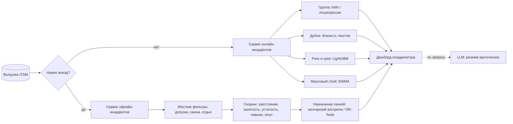

# Предложение для менторов: два сервиса и лёгкие модели вместо LLM везде

**Идея.** Разделить работу с инцидентами на два сервиса: **онлайн-инциденты** решаются удалённо, **офлайн-инциденты**
требуют выезда. Почти все задачи в обоих сервисах — классификация, ранжирование и простая математика. Для них хватает
лёгких моделей, которые работают на процессоре за миллисекунды. LLM остаётся только там, где нужен связный текст, и
вызывается по запросу.

**Железо.** Всё, кроме опциональной LLM, помещается на одну виртуальную машину с 2–4 ядрами и несколькими гигабайтами
памяти, без видеокарты.

## Схема

Признак «нужен выезд» берётся из сервиса и сценария: справочник «сервис/сценарий → удалённо или на месте». Если
справочника нет, его можно предсказать тем же классификатором, что и группу.

## Сервис 1: онлайн-инциденты

| Задача | Модель | Нагрузка |
|---|---|---|
| **Какой группе передать** | Сейчас в дашборде: kNN по истории — какая группа решала тот же продукт, сервис и сценарий. Следующий шаг: TF-IDF по заголовку и описанию плюс категориальные поля → логистическая регрессия или линейный SVM. Если нужно понимать смысл текста — маленький эмбеддер для русского языка (`rubert-tiny2`, около 29 млн параметров) и kNN или логрегрессия поверх | процессор, миллисекунды, десятки–сотни МБ памяти |
| **Дубли и мастер-инцидент** | Косинусная близость текстов (TF-IDF или тот же эмбеддер) плюс фильтр по продукту и окну времени | процессор, мгновенно |
| **Риск сорвать дедлайн или стать критическим** | Градиентный бустинг (LightGBM или CatBoost) на табличных признаках: приоритет, срочность, влияние, тип сервиса, загрузка группы, доля прошедшего времени, число переназначений. Текущая формула в дашборде — логистическая регрессия с весами вручную; её можно обучить на истории | процессор, микросекунды |
| **Сколько займёт решение** | LightGBM с квантильной регрессией: «с вероятностью 80% решат за N часов» | процессор, микросекунды |
| **Начинается массовый сбой** | Без ML: счётчик инцидентов по продукту в скользящем окне, EWMA или z-score. Всплеск → сигнал координатору | почти ноль |
| **Резюме для координатора** | Шаблон из полей выгрузки. LLM — только по запросу и только для критических, как сейчас в дашборде | API по требованию |

## Сервис 2: офлайн-инциденты (подбор исполнителя на выезд)

Подбор строится в три слоя, от простого к сложному.

### Слой 1. Жёсткие фильтры, без ML

Отсекают тех, кого назначать нельзя:

- нет нужного допуска или навыка;
- не на смене;
- превышен лимит рабочих часов или не было положенного отдыха.

Правила отдыха и переработок нужно сверить с трудовым законодательством и внутренними регламентами. Это ограничения,
а не веса: их нельзя «перевесить» хорошим расстоянием.

### Слой 2. Скоринг оставшихся

Прозрачная взвешенная сумма признаков. Диспетчер видит, из чего сложился балл, и может с ним не согласиться.

| Признак | Как считать |
|---|---|
| **Расстояние и время в пути** | Минимум: расстояние по прямой (haversine) × коэффициент извилистости дорог и средняя скорость по региону. Лучше: свой OSRM или Valhalla по нужным регионам (вся Россия целиком требует много памяти). Или API картографического сервиса |
| **Занятость** | Открытые задачи и сколько осталось до конца смены |
| **Усталость** | Часы за последние 24 ч и 7 дней, ночные смены, сколько уже ездил сегодня, время с последнего отдыха |
| **Навыки** | Совпадение нужных навыков с навыками сотрудника, например коэффициентом Жаккара. Нужные навыки берутся из сервиса и сценария |
| **Опыт** | Сколько похожих инцидентов закрыл, доля решённых с первого выезда. Сглаживание байесовское, чтобы новичок с 1 из 1 не обогнал опытного с 45 из 50 |

В интерфейсе — разбор балла, например: «40 мин езды · свободен · 3 похожих закрыл · 6 ч на смене». Такое решение проще
объяснить, чем «так решила нейросеть».

### Слой 3. Когда накопится история

- **Обучить веса скоринга:** ранжирование (LightGBM LambdaRank) по прошлым назначениям с исходом — решил ли с первого
  выезда, как быстро доехал.
- **Несколько выездов сразу:** это задача о назначениях. Если каждому исполнителю один выезд — венгерский алгоритм
  (`scipy.optimize.linear_sum_assignment`). Если один инженер объезжает несколько точек — маршрутизация (VRP) через
  Google OR-Tools. Всё на процессоре, пересчёт пачкой раз в несколько минут.
- **Точнее время в пути:** поправка LightGBM к расчётному времени по фактическим поездкам.

## Где LLM действительно полезна

- **Свободный текст → структура:** понять из описания, что нужен, например, «электрик с допуском к работе на высоте».
  Но и это сначала можно закрыть классификатором.
- **Резюме и объяснения** для критических инцидентов.
- **Без внешнего API:** маленькая локальная модель (например, Qwen2.5 на 1,5–3 млрд параметров в квантизации через
  llama.cpp). Пойдёт на процессоре, но медленно — поэтому только по запросу, не на каждый инцидент.

## Что нужно, чтобы это заработало

1. **Новые данные для офлайн-сервиса.** В нынешней выгрузке их нет:
   - адрес или координаты инцидента;
   - справочник сотрудников: база, навыки, допуски;
   - графики смен и отработанные часы;
   - история выездов: кто, когда выехал, когда прибыл, решил ли с первого раза.

   Для демонстрации их придётся сгенерировать.
2. **История для обучения.** В выгрузке из ТЗ 44 инцидента — для обучения моделей этого мало. План: сейчас правила и
   kNN, по мере накопления истории — LightGBM и ранжирование. Архитектура не меняется, меняется только модель внутри
   сервиса.
3. **Справочник «сервис/сценарий → удалённо или на месте».** От него зависит, в какой сервис попадёт инцидент.

## Что уже сделано в дашборде

| Задача | Сейчас |
|---|---|
| Онлайн- и офлайн-центр | два экрана координатора и два вида кабинета сотрудника, вход по ролям |
| Подбор исполнителя, слой 1 | жёсткие фильтры: перерыв, конец смены (`rankWorkers` в `server/ai-heuristic.ts`) |
| Подбор исполнителя, слой 2 | балл 0–100 с разбором: опыт со сглаживанием, навык, занятость, усталость, время в пути от текущего места |
| Подбор исполнителя, слой 3 | распределение пачкой венгерским алгоритмом (`planBatch`, `hungarian`) |
| Риск | логистическая формула с весами вручную (`assessRisk`) |
| Дубли и причины | по признакам `isMaster`, `isDouble`, `isEffect`, `isReason` и окну времени (`findCorrelation`) |
| Резюме | шаблон; Claude — по запросу, если задан ключ (`server/ai-llm.ts`) |

Чего ещё нет в выгрузке и что сгенерировано для демонстрации: место выезда (площадки в ЮФО), база и график сотрудников. Время в пути — по прямой с коэффициентом дороги; следующий шаг — OSRM по ЮФО.
